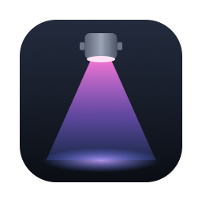

# Vibelights

A DMX lighting controller for macOS: Looks that stack and fade, Effects, a live Stage Plan and MIDI Triggers, driving fixtures through an ENTTEC DMX USB Pro, with an iPad page for working the lights from anywhere in the room.

**[Download the latest release](https://github.com/davecroz/vibelights-releases/releases/latest)**: unzip it and move Vibelights.app into Applications. It needs macOS 15 or later on an Intel Mac, or Apple silicon with Rosetta. After that, Vibelights → Check for Updates… installs new releases.

Free to use under the [Vibelights License](LICENSE.md). What changed in each release: [CHANGELOG.md](CHANGELOG.md).
